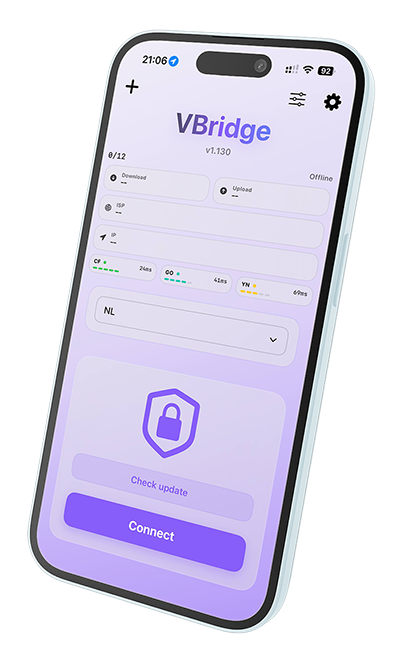

# VBridge

**VBridge** is a network utility. It allows you to securely route your iOS network traffic through TURN servers and WireGuard / Amnezia WG endpoints.

To run the application, you must use a [server](https://github.com/cacggghp/vk-turn-proxy/releases/tag/v1.0.0) running on a VPS.

The project is based on the repositories listed in the **Acknowledgments** section.

## Extended features:

* **Auto-Update Pipeline:** The app can check GitHub Releases and download the latest IPA directly.
* **Manual Update Trigger:** Dedicated **Check update** action on the main screen.
* **Manual Captcha Mode:** Optional mode to disable automatic captcha solving and force manual flow.
* **Amnezia 2.0 Config Support:** Import and use Amnezia 2.0 `.conf` profiles directly.
* **Split Tunneling:** App-wide direct / tunnel routing rules for domains, wildcard domains, IPs, and CIDR ranges, with import/export support.
* **Widget Support:** Small and medium widgets with live connection state, relay IP, and ping dots for Cloudflare / Google / Yandex.
* **Live Activities / Dynamic Island:** Shows VPN connection progress, compact status, relay IP, and ETA while the app is in the background.
* **Shortcut Support:** Connect, disconnect, or toggle the VPN from Shortcuts.
* **Theme Control:** User-selectable app theme (System / Light / Dark).
* **Modernized UI:** Refreshed iOS-style layout with glass cards and status-focused connect controls.
* **CI/CD Release Automation:** GitHub Actions build pipeline with automatic versioning (`3.X`, starting at `3.1`) and release artifact publishing.
* **Built-In WDTT Server Management:** Deploy, inspect, and manage a WDTT server directly from the app, including client listing, create/edit/delete actions, cleanup actions, runtime limits, reinstall flows, and server state export.
  Deploy offers **WDTT Simple**, **WDTT**, **WDTT Plus**, and **SRTP**. WDTT Simple uses the [imported simple server](third_party/wdtt-stable/VBRIDGE.md). WDTT restores the implementation used before commit `92c0070`; WDTT and WDTT Plus build from `third_party/wdtt-server`, with separate installers and runtime settings. CSQTT remains supported internally but is hidden from Deploy.
* **Client Transfer and Share Flows:** Move a WDTT client separately via transfer code, file export/import, quick link, or QR code, with camera-based QR import and compatibility with modern `wdtt://connect?...` links.
  In WDTT client management, **Other Link** offers VK TURN Proxy (`vkturnproxy://import?data=...`, schema v1, SRTP-WRAP-A) and classic WDTT (`wdtt://host:dtls:wg:local:password:hash[,hash]`) exports. Clients can be created without VK calls. For VK TURN Proxy exports, leaving calls empty preserves the receiving app's existing call list; providing calls replaces it. Classic WDTT links require a call URL or hash in the client's Edit settings. Classic links cannot represent IPv6 hosts or passwords containing colons/whitespace; use the VK TURN Proxy option for those. SRTP client management has a **Quick Link** action for VK TURN Proxy's SRTP mode, including the client's WireGuard keys, address, DNS, AllowedIPs and optional PSK; the VK call URL/hash in the Quick Link section is optional and has the same preserve-or-replace behavior. Existing VBridge Copy Profile/Export actions remain available. Formats were checked against [vk-turn-proxy-ios](https://github.com/anton48/vk-turn-proxy-ios/blob/main/VKTurnProxy/VKTurnProxy/BackupManager.swift) and its [link generator](https://github.com/anton48/vk-turn-proxy-ios/blob/main/quick_link.py).
* **User and Admin Separation:** User-facing VPN connection workflows stay available without server administration, while deploy and server-management tools remain grouped under the admin flow.
* **Safer WDTT Reinstall and Recovery:** Reinstall, uninstall, update-preserve, backup, export, and import flows are integrated around the migrated WDTT-Plus-style server management model.
  WDTT Simple supports native Server Backups, including automatic schedules, retention settings, manual creation, verification, export and deletion. Exported snapshots and legacy state archives can be restored from Deploy → Restore Server, with database adaptation and rollback on failed startup. Simple keeps its server backup catalog separately from WDTT/Plus; current deployment credentials are retained during restore. This requires updating both VBridge and the installed WDTT Simple server.
  Before installing or updating WDTT Simple, WDTT or WDTT Plus, VBridge stops the service, validates and adapts `passwords.json`, and backs up the original database and `wg-keys.dat` under `/etc/vbridge-backups/wdtt/`. Missing owner credentials are restored from the deploy settings. Client keys, access passwords, expiry dates and traffic counters are retained. WDTT and WDTT Plus support one bound device per access: switching from a multi-device WDTT Simple access stops with an error until extra devices are unbound or given separate accesses. Invalid databases are never silently reset. Plus-only fields may be discarded by WDTT Simple when it saves its database; the original remains in the backup. This migration requires Python 3 on the VPS.
* **Advanced WDTT Runtime Controls:** Per-profile WDTT settings include VK Calls preflight, fingerprint mode, client ID filtering, worker import hints from WDTT links, and quick-link generation from the profile screen.
* **Resilient VK Bootstrap Path:** WDTT startup prefers the VK Calls path, supports pre-bootstrap TURN probing, preserves a stable device identity, and falls back into captcha-aware recovery only when required.
* **Shareable Admin-State Transfer:** Deploy settings and local server state can be exported from the app for migration or recovery workflows.

## ✨ Features

* **Custom Routing:** Route your traffic through specific TURN protocols and WG endpoints.
* **WireGuard & Amnezia WG Integration:**
  - Complete WireGuard protocol support with key management, routing, and DNS configuration
  - Full Amnezia WireGuard obfuscation support including jitter parameters (Jc, Jmin, Jmax), packet size obfuscation (S1-S4), and magic headers (H1-H4)
* **Advanced TURN Controls:** Optional UDP/TCP transport override and TURN host/port override for edge cases and alternate TURN endpoints.
* **Split-Tunnel Rules:** Choose whether matching traffic bypasses the VPN or whether only matching traffic goes through the VPN. Supports `example.com`, `*.example.com`, `1.2.3.4`, and `1.2.3.0/24`.
* **Multi-Threaded Proxy:** Default multi-connection mode is tuned for higher throughput, with per-profile control for stability.
* **1-Click Import:** Quickly import complex configurations via base64-encoded clipboard links (`vbridge://`).
* **Multi-Profile Management:** Create, edit, and seamlessly switch between multiple VPN configurations using a convenient dropdown picker.

## 📸 Screenshot



## 🚀 Installation & Build

To build and run VBridge locally, you need a macOS environment with Xcode installed, as well as Go (for compiling the WireGuard/TURN bridge).

> ⚠️ **Important:** VBridge uses a Network Extension (VPN). Signing with a **free Apple ID** (via standard AltStore or Sideloadly) **will not work** because free accounts lack the required VPN entitlements. You must use a paid Apple Developer account ($99/year) or a third-party paid signing service.

1. **Clone the repository:**

   ```bash
   git clone https://github.com/nullcstring/turnbridge.git
   cd VBridge
   ```
2. **Build the Go Bridge:**
   Ensure you have Go installed (`brew install go`).

Modify the Go path in the script at script/build_wireguard_go_bridge.sh, according to your setup. Refer to [this Stack Overflow answer](https://stackoverflow.com/a/64212121) for guidance.

3. **Open the project in Xcode:**
   Open the Xcode project (or `.xcworkspace` if applicable) in Xcode.
4. **Configure Code Signing:**

* Select the `VBridge` project in the Project Navigator.
* Go to the **Signing & Capabilities** tab.
* Select your personal Apple Developer Team.
* Ensure you update the Bundle Identifier (for both the main app and the `network-extension` target) to match your team provisioning profile.

5. **Build and Run:**
   Select your target device (iPhone/iPad) and press `Cmd + R` to build and run the app.

## 📲 Install Pre-built IPA

If you don't have a Mac or Xcode, you can download the pre-built unsigned IPA from the [Releases](https://github.com/nullcstring/turnbridge/releases) page and sign it yourself.

### Signing & Installation

**Manual Installation Tools:**
If you already possess a paid Apple Developer certificate (or bought one from the services above), you can sign and install the IPA yourself using:

| Tool                                 | Requirement                                                                                                                |
| ------------------------------------ | -------------------------------------------------------------------------------------------------------------------------- |
| [KravaSign](https://www.kravasign.com/) | ⚠️ Without a developer certificate, price $10 https://github.com/nullcstring/turnbridge/issues/2#issuecomment-4129716584 |
| [GBox](https://gbox.run)                | Paid Certificate Needed                                                                                                    |
| [ESign](https://esign.yyyue.xyz)        | Paid Certificate Needed                                                                                                    |

## 🛠 Usage (Configuration Import)

VBridge uses a specific JSON structure encoded in Base64 for fast configuration imports for WireGuard / Amnezia WG.

### Configuration JSON Structure

```json
{
  "turn": "https://vk.com/call/join/...",
  "peer": "SERVER_IP:PORT",
  "listen": "127.0.0.1:9000",
  "n": 16,
  "turnHost": "",
  "turnPort": "",
  "udp": true,
  "wg": "[Interface]\nPrivateKey = ...\nAddress = 10.100.0.2/32\nDNS = 8.8.8.8\nMTU = 1280\n\n[Peer]\nPublicKey = ...\nAllowedIPs = 0.0.0.0/0\nEndpoint = 127.0.0.1:9000\nPersistentKeepalive = 25"
}
```

### Generate a Quick Import Link

You can use the included `quick_link.py` script to easily generate valid `vbridge://` clipboard links.

1. Open `quick_link.py` in your text editor and replace the placeholder values in the `config` dictionary with your actual server parameters and WireGuard keys.
2. Run the script from your terminal:

   ```bash
   python3 quick_link.py
   ```
3. Copy the generated `vbridge://...` link from the terminal output to your iOS clipboard.
4. Open VBridge, tap the `+` icon, select **Paste from Clipboard**, and tap **Connect**.

You can also import an Amnezia WireGuard `.conf` file through **Import from File**. During import, the original `Endpoint` is saved as `Peer Address (IP:Port)`, while the stored WireGuard config is rewritten to use `Endpoint = 127.0.0.1:9000`.

## Split Tunneling

VBridge includes an app-wide **Split-Tunneling** screen available from the main toolbar and from **Settings → Extended Features**.

Supported rules:

* Exact domains: `example.com`
* Wildcard domains: `*.example.com`
* Single IP addresses: `1.2.3.4`
* CIDR ranges: `1.2.3.0/24`

Available modes:

* **Open domains and IPs directly**: matching traffic bypasses the VPN tunnel.
* **Open domains and IPs through tunnel**: only matching traffic goes through the VPN tunnel.

Lists can be edited manually, imported from local `.txt` files or remote text URLs, and exported as `vbridge-split-data.txt`.
The settings screen can also refresh the domain, CIDR subnet, and optional individual-IP lists from
[`hxehex/russia-mobile-internet-whitelist`](https://github.com/hxehex/russia-mobile-internet-whitelist).
The individual-IP list is very large; prefer the CIDR list unless exact host routes are required.

## Widget and Shortcuts

**Settings → Routing → Bypass VPN Tunnel** sends traffic directly while keeping the
VPN session running. Turning it off restores the tunnel's routes and DNS, including
split-tunneling rules. The preference also applies to the next connection.

The Live Activity shows the profile, connection status, session timer, and relay
details. On iOS 17 or later, its **Bypass VPN Tunnel / Use VPN Tunnel** and
**Disconnect** buttons work without opening the app. Bypass state changes after
the tunnel extension confirms the routing change. If the app stops refreshing the
activity, it shows **Last known** and hides the timer until refreshed.

VBridge includes two widget sizes:

* **Small widget:** VPN state, connection count, relay IP, and tap-to-toggle behavior.
* **Medium widget:** everything from the small widget plus live ping dots for `Cloudflare`, `Google`, and `Yandex`. Ping values refresh about every 30 seconds while connected.

The app also exposes Shortcuts actions so you can connect, disconnect, or toggle the VPN from the Shortcuts app or Control Center shortcuts.

## Support VBridge

**Crypto:**

* **TON:** UQCwaqdfd_mAjc1GYvgYOI7CDDNXgOlTiZvRFI2SvjvfY8Tm

## License

VBridge is released under the [GNU General Public License v3.0](LICENSE).

Copyright (C) 2026 prodject

This program is free software: you can redistribute it and/or modify
it under the terms of the GNU General Public License as published by
the Free Software Foundation, either version 3 of the License, or
(at your option) any later version.

This program is distributed in the hope that it will be useful,
but WITHOUT ANY WARRANTY; without even the implied warranty of
MERCHANTABILITY or FITNESS FOR A PARTICULAR PURPOSE. See the
GNU General Public License for more details.

---

## Acknowledgements

This project was made possible thanks to the work of the open-source community. It includes code and concepts from the following excellent repositories:

* [turnbridge](https://github.com/nullcstring/turnbridge) — Original iOS client base and design direction.
* [WireGuard-Apple](https://github.com/ut360e/wireguard-apple) — Licensed under MIT / GPL.
* [Wireguardkit](https://github.com/Shahzainali/Wireguardkit) — Licensed under MIT / GPL.
* [vk-turn-proxy](https://github.com/cacggghp/vk-turn-proxy) — Licensed under the GNU GPL.
* [vk-turn-proxy-ios](https://github.com/anton48/vk-turn-proxy-ios) — Licensed under MIT; source for the DTLS+WG phased startup, SRTP-WRAP, and SRTP-WRAP-A / WDTT transport runtime integration.
* [Amneziawg-Apple](https://github.com/amnezia-vpn/amneziawg-apple.git) — Licensed under MIT.
* [WINGSV](https://github.com/WINGS-N/WINGSV) — Licensed under the GNU GPL.
* [proxy-turn-vk-android](https://github.com/amurcanov/proxy-turn-vk-android) — Licensed under the GPL-3.0.
* [proxy-turn-vk-android-server-fix](https://github.com/michaillepichow/proxy-turn-vk-android-server-fix) — Licensed under the GPL-3.0.
* [WDTT-Plus](https://github.com/Ivan4537/WDTT-Plus) — Source reference for the migrated WDTT server-management model, admin flows, and client transfer/share compatibility.
